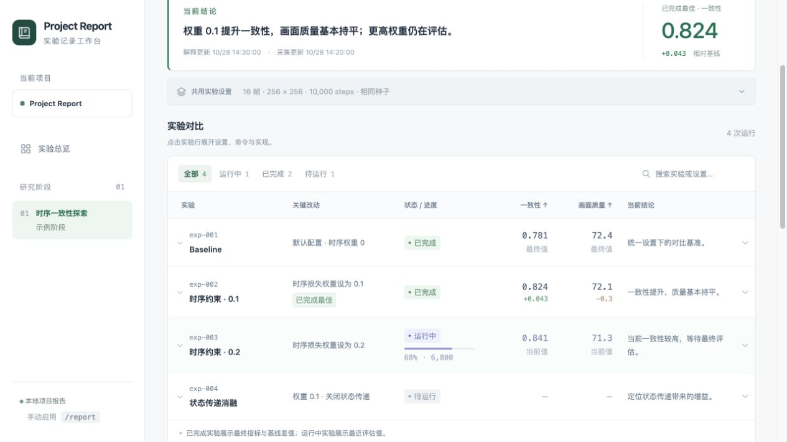

# Project Report

一个手动启用的 Codex skill，将实验进度、结果、设置和实现整理成可浏览的本地报告。

**一个总览首页 → 每个阶段一个页面 → 阶段内一张持续更新的实验表。**



图中的实验、指标、配置和运行状态均为示例数据。

## 能做什么

- 总览当前阶段、正在运行的实验与最近更新时间。
- 一次运行对应一行，进度和指标持续更新；复跑保留独立记录。
- 点击实验行查看完整配置、启动命令、关键实现、资源使用和产物位置。
- 区分运行中的当前指标与已完成实验的最终指标，并展示基线差值与曲线。
- 用短篇 Markdown 保存阶段解释与下一步，支持附加图片和视频。
- 通过实验进程写入数据，本地网页每 5 秒读取最新记录。

## 安装与手动启用

在 Codex 中使用内置的 skill-installer：

```text
$skill-installer 安装 https://github.com/AlexHu-1215/project-report/tree/main/skills/report
```

安装后的技能名为 `report`。在 `/` 菜单中选择 `report`，或输入：

```text
$report
```

技能设置了 `allow_implicit_invocation: false`。用户在当前会话显式启用后持续记录，每个新会话由用户重新启用。

初始化时，Codex 会将自带的[项目原则](skills/report/assets/project-principles.md)合并到目标项目的 `AGENTS.md`，并创建 `report/`。原则覆盖精简实现、GPU 优先、根因修复、肯定表达和训练性能，可在安装前查看模板。

## 本地查看示例

运行环境为 Python 3 和现代浏览器；报告脚本使用 Python 标准库。

```sh
git clone https://github.com/AlexHu-1215/project-report.git
cd project-report
python3 skills/report/scripts/report.py init --project .
python3 skills/report/scripts/report.py demo --project .
python3 skills/report/scripts/report.py serve --project . --port 8765
```

打开 [http://127.0.0.1:8765](http://127.0.0.1:8765)。服务监听本机地址，随启动它的进程运行。`demo` 在首次演示时生成示例阶段。

需要保存当前可离线浏览的页面时运行：

```sh
python3 skills/report/scripts/report.py build --project .
```

生成的 `report/index.html` 可直接打开，整个 `report/` 文件夹可一起移动。

## 接入真实实验

每次运行独立保存 JSON 记录。将 `Run.create()`、`Run.update()`、`Run.finish()` 接入已有实验流程，即可记录实际配置、step 和评估指标。后台实验携带采集调用，网页展示已采集的最新数据；Codex 根据结果补充解释。

阶段结构、字段说明和采集示例见[数据与采集约定](skills/report/references/recording.md)。

## 仓库内容

```text
skills/report/
  SKILL.md                    # Codex 工作流程
  agents/openai.yaml          # 手动启用配置
  scripts/report.py           # 初始化、采集、生成与本地服务
  assets/                     # 页面样式、交互、原则和示例数据
  references/recording.md      # 数据结构与实验接入说明
docs/preview.png              # 页面预览
```

项目生成的 `report/` 和本地 `AGENTS.md` 由 `.gitignore` 排除。用于分发的原则模板与示例数据保存在 skill 的 `assets/` 中。
