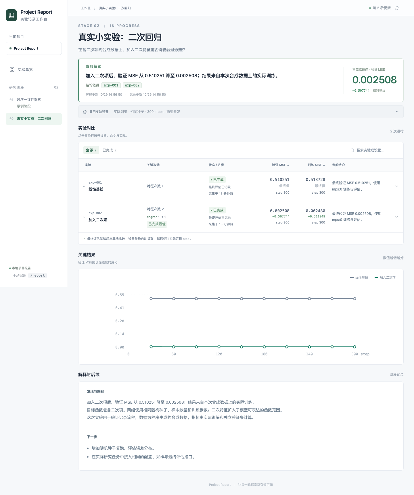

# 实际实验验证

验证日期：2026-10-29。训练、评估与配置记录均在实际执行中产生，数据为程序生成的合成数据。

## 实验条件

- 设备：Apple M4，PyTorch 2.15.0，MPS；模型参数和训练张量的设备均为 `mps:0`。
- 任务：拟合包含线性项与二次项的目标函数，比较线性回归和加入二次特征的回归模型。
- 设置：种子 42，8 个输入维度，65,536 个训练样本，32,768 个独立验证样本，300 步 SGD，学习率 0.05，噪声标准差 0.05。
- 执行：两个实验并发，完整训练批次常驻 GPU，每 30 步评估一次，最后独立计算并提交最终指标。

| 实验 | 特征次数 | 验证 MSE | 训练 MSE | 训练循环与周期验证耗时 |
|---|---:|---:|---:|---:|
| 线性基线 | 1 | 0.510251403 | 0.513728142 | 0.438 s |
| 加入二次项 | 2 | 0.002507583 | 0.002479546 | 0.438 s |

目标函数包含二次项，第二组模型具备对应的表达能力。这次结果验证了实际训练到报告的记录流程；固定种子和合成数据界定了结论的适用范围。



## 完整流程的验证

1. 统一入口创建阶段和两次运行，分别保存计划配置与代码。
2. 第二组登记时的 batch 为 16,384，实际启动前调整为 65,536；启动快照和程序解析后的配置均记录了 65,536，计划记录保持 16,384。
3. 训练指标与实际采样 step 按行追加，最终评估显式提交；两个进程正常退出，最终指标完整。
4. 初始结论保留登记时的结果范围。真实评估产生后，系统识别到结论待更新。
5. 新结论引用两条实验行，保存各自指标与审阅时的结果。页面自动显示实际配置差异。
6. 浏览器回归验证了阶段查询、局部刷新、视频连续播放、文字选择、滚动位置、证据定位、移动布局与离线快照。

Python 与前端回归还覆盖了中途正常退出、提前停止后提交评估、最终指标缺失、后续训练使最终评估失效、启动时配置或代码变动、追加文件的完整行读取和其他阶段的数据隔离。

## 复现

```sh
python3 -m venv .venv
.venv/bin/python -m pip install -r examples/tiny-regression/requirements.txt
.venv/bin/python examples/tiny-regression/run.py
python3 skills/report/scripts/report.py serve --project . --port 8765
```

打开 `http://127.0.0.1:8765/stages/02-gpu-regression/index.html`。原始评估、模型和验证记录保存在 `report/artifacts/02-gpu-regression/`，采样事件保存在 `report/data/events/02-gpu-regression/`。复跑分配新的运行 ID。
